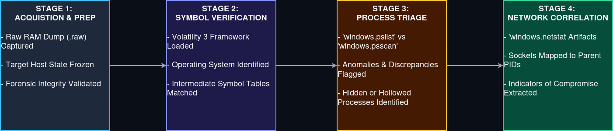

# Incident 05: Memory Forensics

## 1. Executive Summary

* **Objective:** Perform volatile memory analysis on a host system RAM dump using Volatility 3 to uncover stealthy process execution, hidden persistence mechanisms, and anomalous network connections.
* **Core Focus:** Transitioning from disk-based logs to host RAM triage, validating operating system symbols, comparing active vs. unlinked processes, and correlating netstat artifacts.
* **Outcomes:** Uncovered hidden execution indicators and correlated anomalous network ports back to suspicious process IDs (PIDs) for incident escalation. 

---

## 2. Architecture & Data Flow

Below is the end-to-end memory forensics pipeline mapping how a volatile RAM dump is ingested, verified, triaged, and correlated for L1 reporting.

---

## 3. Workflow Breakdown (The 4-Stage Pipeline)

### Stage 1: Acquisition & Preparation

* **Action:** Capturing host RAM state.
* **Mechanism:** Ingesting a raw volatile memory dump (`.raw` or `.dmp`) captured via forensic acquisition tools from the target workstation. 

### Stage 2: Symbol Verification & OS Profiling 

* **Action:** Establishing target environment parameters.
* **Mechanism:** Utilizing Volatility 3 intermediate symbol files and running baseline checks (e.g., `windows.info`) to map kernel structures and ensure accurate plugin execution. 

### Stage 3: Process Triage & Anomaly Hunting

* **Action:** Identifying active and hidden processes.
* **Mechanism:** Enumerating running tasks via `windows.pslist` and comparing results against raw scans (`windows.psscan`) to surface unlinked or hidden processes indicative of rootkit activity. 

### Stage 4: Network & Injection Correlation 

* **Action:** Connecting host sockets to process binaries. 
* **Mechanism:** Running `windows.netstat` to map active network connections to specific PIDs, followed by verifying memory sections for injected DLLs or hollowing artifacts. 

---

## 4. Key Artifacts & Components 

* **RAM Dump:** Raw volatile memory containing transient system state, active registry keys, process memory, and open network sockets. 
* **Volatility 3 Framework:** Modern, Python-based memory analysis engine utilizing symbol tables rather than hardcoded profiles. 
* **Process Discrepancies:** Key analytical findings showing differences between active API process lists and raw kernel memory scans. 

---

## 5. Operational Takeaways 

By integrating foundational memory forensics into the L1 workflow, the SOC achieves:

1. **Visibility Beyond the Disk:** Detecting fileless malware, process injection, and payloads that evade traditional static file signatures.
2. **Defensible Root-Cause Analysis:** Correlating volatile network sockets directly to the executing process ID to confirm C2 callback activity.
3. **Structured Investigation Discipline:** Following a repeatable, step-by-step memory triage methodology rather than relying on guesswork. 
