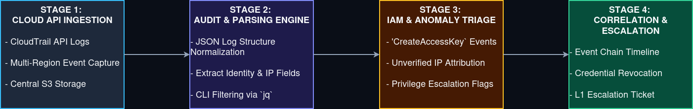

# Incident 06: Cloud Security Operations & Telemetry Triage

## 1. Executive Summary

* **Objective:** Ingest and analyze AWS CloudTrail management plane logs to detect unauthorized IAM identity usage, suspicious credential generation, and anomalous API activity.
* **Core Focus:** Establishing cloud audit visibility, parsing JSON event structures via command-line utilities, identifying compromised access keys, and tracking adversary actions in cloud environments.
* **Outcome:** Traced an unauthorized `CreateAccessKey` event back to an unverified IP address, validated identity attribution, and drafted L1 containment steps.

---

## 2. Architecture & Data Flow

The data flow below maps how AWS management plane activity moves from cloud endpoints into centralized log storage for L1 analyst triage.



---

## 3. Workflow Breakdown (The 4-Stage Pipeline) 

### Stage 1: Cloud API Ingestion

* **Action:** Capturing cloud management plane telemetry.
* **Mechanism:** Aggregating continous multi-region API logs via AWS CloudTrail into a centralized, secured storage bucket.

### Stage 2: Audit & Parsing Engine

* **Action:** Normalizing structured event records and parsing key metadata fields.
* **Mechanism:** Utilizing command-line utilities (`jq`) to filter raw JSON CloudTrail log bundles down to targets security events.

```bash
# Filter raw CloudTrail log bundle for IAM 'CreateAccessKey' events and extract identity/IP fields
jq '.Records[] | select(.eventName == "CreateAccessKey") | {User: .userIdentity.userName, IP: .sourceIPAddress, EventTime: .eventTime}' sample-cloudtrail.json
```

**Sample Input Event (`sample-cloudtrail.json`):**

```json
{
  "Records": [
    {
      "eventVersion": "1.08",
      "eventTime": "2026-10-20T14:22:05Z",
      "eventSource": "iam.amazonaws.com",
      "eventName": "CreateAccessKey",
      "awsRegion": "us-east-1",
      "sourceIPAddress": "198.51.100.42",
      "userAgent": "aws-cli/2.15.0",
      "userIdentity": {
        "type": "IAMUser",
        "userName": "dev-admin-svc"
      }
    }
  ]
}
```

**Parsed Command Output:**

```json
{
  "User": "dev-admin-svc",
  "IP": "198.51.100.42",
  "EventTime": "2026-10-20T14:22:05Z"
}
```
 
### Stage 3: IAM & Anomaly Triage

* **Action:** Detecting unauthorized access and policy modifications.
* **Mechanism:** Flagging suspicious API calls such as `CreateAccessKey` or privilege alterations originating from unfamiliar public IP addresses or non-MFA sessions. 

### Stage 4: Incident Correlation & Escalation 

* **Action:** Building the incident timeline and containment plan.
* **Mechanism:** Correlating API event chains to map compromised credentials, revoke active session tokens, and writing the final escalation ticket.

---

## 4. Key Artifacts & Components

* **CloudTrail API Logs:** Immutable event records documenting management plane requests executed by users, roles, or services.
* **IAM Telemetry:** Logs recording credential generation, policy attachments, and role modifications. 
* **CLI Parsing:** Text utilities (`jq`, `grep`) used to query large JSON datasets during triage. 

---

## 5. Operational Takeaways 

1. **Identity Focus:** Cloud defense relies heavily on tracking identity management, API key lifecycles, and session permissions rather than traditional network perimeters. 
2. **Precise Timelines:** CloudTrail's strict UTC ISO timestamps allow for rapid, unambiguous event reconstruction.
3. **Proactive Review:** Regular audits of IAM policies help catch misconfigurations or persistent backdoors early.

---

## 6. Limitations & Next Steps

* **Log Ingestion Daily:** Real-world CloudTrail delivery to S3 can experience latency; live alerting typically requires EventBridge integration.
* **Log Integrity:** This analysis assumes log transport integrity; mature environments require verifiying cryptographic hashes (`ValidateDigest`) to rule out log tampering.
* **Next Steps:** Integrating SOAR workflows to automatically revoke compromised access keys upon anomaly detection. 
