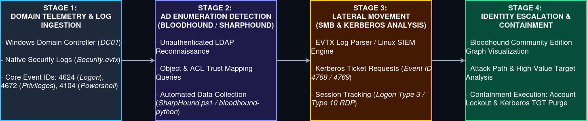

# Incident 07: Active Directory Enumeration & Lateral Movement

## 1. Executive Summary

* **Objective:** Detect and triage Active Directory (AD) reconnaissance and lateral movement techniques using Windows Security Event Logs and BloodHound relationship mapping. 
* **Core Focus:** Transitioning from standalone host logs to domain-wide identity monitoring, identifying abnormal LDAP enumeration traffic, and tracing SMB/RPC-based lateral movement vectors.
* **Outcome:** Successfully correlated anomalous Kerberos and object-query patterns to surface compromised credentials and initiate containment playbooks before privilege escalation succeeded.

---

## 2. Architecture & Data Flow

Below is the end-to-end Active Directory monitoring and triage pipeline mapping how domain telemetry is ingested, filtered, and analyzed for identity-based threats.

---

## 3. Workflow Breakdown (The 4-Stage Pipeline)

### Stage 1: Domain Telemetry & Log Ingestion

* **Action:** Capturing authentication and directory service activity across domain controllers.
* **Mechanism:** Aggregating Windows Security Event Logs (specifically Logon/Logoff, Account Modification, and Directory Service Access) alongside PowerShell script block logging (Event ID 4104). 

### Stage 2: AD Enumeration Detection (BloodHound / SharpHound)

* **Action:** Identifying automated reconnaissance traffic.
* **Mechanism:** Analyzing high-volume LDAP queries (`SearchFilter` patterns requesting ACLs, group memberships, and trust relationships) associated with unauthenticated or low-privileged enumeration tools.

### Stage 3: Lateral Movement Triage (SMB & Kerberos Analysis)

* **Action:** Tracking suspicious authentication and session creation across network boundaries.
* **Mechanism:** Correlating Logon Type indicators (e.g., Logon Type 3 network logons followed by Type 10 RDP or remote service creation) to spot Pass-the-Hash or stolen credentials replay attacks.

### Stage 4: Identity Escalation & Containment 

* **Action:** Isolating compromised domain accounts and sessions.
* **Mechanism:** Forcing credential resets on targeted service accounts, invalidating active Kerberos tickets (TGT purges), and isolating compromised workstations from the domain controller network.

---

## 4. Key Artifacts & Components 

* **Windows Security Event Logs:** Core forensic artifacts including Event ID 4624 (Successful Logon), Event ID 4672 (Special Privilege Assigned), and Event ID 4768/4769 (Kerberos Ticket Requests). 
* **PowerShell Script Block Logging (Event ID 4104):** Captures decoded command-line execution strings used during native enumeration or post-exploitation script execution. 
* **BloodHound (Community Edition):** Visual path-analysis tool used to map domain trust relationships, choke points, and administrative exposure paths.

---

## 5. Operational Takeaways

By integrating foundational Active Directory montioring into L1 workflow, the SOC achieves:

1. **Early-Stage Detection:** Catching attackers during the enumeration phase (BloodHound/SharpHound execution) before they achieve Domain Admin status.
2. **Identity Context Visibilty:** Distinguishing between normal administrative maintenance and anomalous remote logon chains across internal network segments.
3. **Structured Incident Scoping:** Quickly identifying the blast radius of compromised credentials by mapping affected domain objects and endpoints. 
