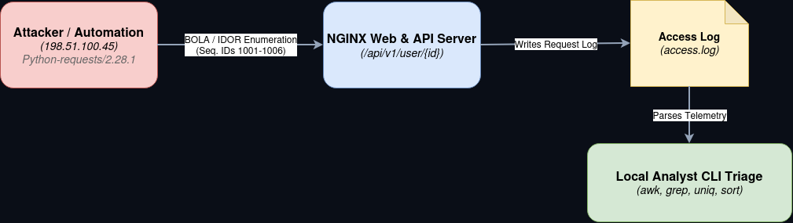

# Incident 08: Web Application & API Attack Triage

## 1. Executive Summary

* **Objective:** Review web application and API logs to investigate potential Broken Object Level Authorization (BOLA / IDOR) and scripted endpoint scanning.
* **Core Focus:** Filtering NGINX access logs using Linux CLI utilities (`grep`, `awk`), spotting unauthorized sequential record access, and determing if real data was exposed.
* **Outcome:** Identified an external host running sequential requests against user endpoints, checked response sizes to confirm data exposure, and outlined basic remediation steps. 

---

## 2. Architecture & Data Flow

Below is the end-to-end web application monitoring and triage pipeline mapping how HTTP access logs and API telemetry are captured, parsed, and analyzed for web-based threats. 



---

## 3. Workflow Breakdown (The 4-Stage Pipeline)

### Stage 1: Initial Alert & Triage 

* **Action:** Reviewing web server alerts for high request rates or unusual status code patterns.
* **Mechanism:** Spotting a cluster of successful HTTP 200 responses targeted at specific object paths or recognizing automated script headers in the access logs. 

### Stage 2: Log Parsing & Telemetry Hunt

* **Action:** Filtering raw text access logs to isolate suspect IP activity.
* **Mechanism:** Running Linux text utilities (`grep`, `awk`, `sort`, `uniq`) to pull specific IP addresses, list requested URL paths, and inspect client user-agent strings.

### Stage 3: Scope & Impact Assessment 

* **Action:** Verifying whether the client actually pulled back valid user data.
* **Mechanism:** Checking HTTP status codes (HTTP 200 vs 403) and calculating response body byte counts to see how many user records returned populated data.

### Stage 4: Remediation & Hardening

* **Action:** Passing recommendations to the app team to fix object access checks.
* **Mechanism:** Documenting the missing authorization check on resource IDs, suggesting basic rate-limiting thresholds, and noting log patterns for future alert rules. 

---

## 4. Key Artifacts & Components

* **NGINX / Apache Access Logs:** Primary log source containing client IPs, timestamps, HTTP methods, requested URI paths (`/api/v1/user/{id}`), status codes, and response sizes.
* **Linux CLI Utilities (`grep`, `awk`, `sort`, `uniq`):** Command-line tools used to filter log lines, count request frequencies, and sum up transferred bytes.
* **API Gateway Telemetry:** Request details tracking client headers, user-agent strings (like `Python-requests`), and session tokens. 

---
 
## 5. Hands-On CLI Triage Walkthrough

The following commands and query sequence were executed within the local test environment (`~/web-attack-testing/`) to simulate log ingestion and parse the web access logs.

```bash
# ==============================================================================
# Step 1: Environment Setup & Sample Log Generation
# ==============================================================================
mkdir -p ~/web-attack-testing/logs && cd ~/web-attack-testing/logs

cat << 'EOF' > access.log
10.0.0.15 - - [29/Oct/2026:14:20:01 +0000] "GET /index.html HTTP/1.1" 200 4522 "-" "Mozilla/5.0 (X11; Linux x86_64)"
10.0.0.22 - - [29/Oct/2026:14:20:15 +0000] "GET /api/v1/health HTTP/1.1" 200 180 "-" "UptimeMonitor/1.0"
198.51.100.45 - - [29/Oct/2026:14:21:10 +0000] "POST /api/v1/login HTTP/1.1" 200 512 "-" "Python-requests/2.28.1"
198.51.100.45 - - [29/Oct/2026:14:21:12 +0000] "GET /api/v1/user/1001 HTTP/1.1" 200 1240 "-" "Python-requests/2.28.1"
198.51.100.45 - - [29/Oct/2026:14:21:13 +0000] "GET /api/v1/user/1002 HTTP/1.1" 200 1285 "-" "Python-requests/2.28.1"
198.51.100.45 - - [29/Oct/2026:14:21:14 +0000] "GET /api/v1/user/1003 HTTP/1.1" 200 1210 "-" "Python-requests/2.28.1"
198.51.100.45 - - [29/Oct/2026:14:21:15 +0000] "GET /api/v1/user/1004 HTTP/1.1" 200 1310 "-" "Python-requests/2.28.1"
198.51.100.45 - - [29/Oct/2026:14:21:16 +0000] "GET /api/v1/user/1005 HTTP/1.1" 200 1290 "-" "Python-requests/2.28.1"
10.0.0.15 - - [29/Oct/2026:14:22:00 +0000] "GET /api/v1/user/1001 HTTP/1.1" 200 1240 "-" "Mozilla/5.0 (X11; Linux x86_64)"
198.51.100.45 - - [29/Oct/2026:14:22:05 +0000] "GET /admin/db_backup.sql HTTP/1.1" 403 230 "-" "Python-requests/2.28.1"
198.51.100.45 - - [29/Oct/2026:14:22:10 +0000] "GET /api/v1/user/1006 HTTP/1.1" 404 150 "-" "Python-requests/2.28.1"
EOF

# ==============================================================================
# Step 2: Forensic Triage Queries
# ==============================================================================

# 1. Identify Top Requesting IP Addresses & Full User-Agents
awk -F'"' '{split($1, a, " "); print a[1], $6}' access.log | sort | uniq -c | sort -nr

# 2. Filter for targeted endpoint sequential requests
grep "/api/v1/user/" access.log | awk '{print $1, $6, $7, $9}'

# 3. Calculate Exfiltrated Data Volume (HTTP 200 Response Body Bytes)
grep "198.51.100.45" access.log | awk '$9 == 200 {sum+=$10} END {print "Total Exfiltrated Bytes (HTTP 200): " sum}'
```
---

## 6. Operational Takeaways

From an L1 triage perspective, investigating API access logs manually reinforces a few key takeaways:

1. **Preserving Full User-Agent Context:** Keeping the complete User-Agent string during log parsing immediately exposes automated tools (like `Python-requests`) versus standard browser activity, saving time on initial triage.
2. **Spotting Enumeration Patterns:** Rapid, sequential calls to user endpoints, such as iterating through IDs `1001` through `1005` in consecutive seconds, provide clear behavioral indicator of a BOLA / IDOR attack that broad alert rules might miss.
3. **Scoping Data Impact:** Summing the response body bytes on successful HTTP 200 requests gives analysts a quick, grounded way to calculate how much data was actually pulled down during the incident window. 
