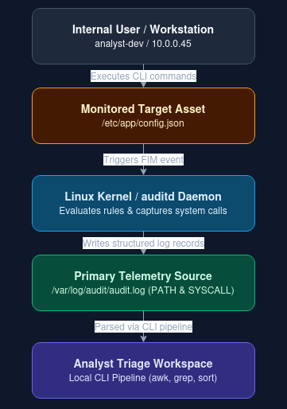

# Incident 09: Insider Threat & Data Exfiltration via File Integrity Monitoring

## 1. Executive Summary

This project focuses on analyzing an insider threat scenario involving unauthorized access, modification, and potential data exfiltration of sensitive configuration files on a Linux system. Using native Linux File Integrity Monitoring (FIM) telemetry from `auditd` along with standard command-line tools, this repository demonstrates how to track file access events, identify suspicious user activity, and evaluate whether data was compromised.

---

## 2. Telemetry & Target Assets

* **Detection Vector:** File Integrity Monitoring (FIM) alerts & Linux system audit logs.
* **Target Asset:** Production database configuration file (`/etc/app/config.json`)
* **Suspect User Account / IP:** Internal user session (`analyst-dev` / `10.0.0.45`)
* **Primary Telemetry Source:** `/var/log/audit/audit.log`

---

## 3. Architecture & Data Flow 



### Component Breakdown

* **Internal User / Account (`10.0.0.45 / analyst-dev`):** The internal user account executing read and modification commands on sensitive system paths.
* **Monitored Filesystem (`/etc/app/config.json`):** The application database configuration file set up under continuous file intergrity monitoring.
* **FIM / Audit Logs (`audit.log`):** System logs captured by `auditd`, recording raw system calls, process identifiers, and access details.
* **Local Analyst CLI Workstation:** The local Linux environment used to parse and analyze log output using native utilities (`awk`, `grep`, `sort`).

---

## 4. Attack Simulation Setup 

To simulate the insider threat scenario locally, a test directory and a sample configuration file containing test credentials was created: 

```bash
mkdir -p ~/fim-testing/etc/app
echo '{"db_host": "localhost", "db_password": "SuperSecretPassword123"}' > ~/fim-testing/etc/app/config.json
```

---

## 5. Hands-On CLI Triage Walkthrough

The following commands simulate generating audit log telemetry and parsing the file access events in a local Linux terminal (`~/fim-testing/`).

```bash
# ==============================================================================
# Step 1: Generate Sample Audit Telemetry
# ==============================================================================
cd ~/fim-testing
mkdir -p logs

cat << 'EOF' > logs/audit.log
type=PATH msg=audit(1762080000.123:45): item=0 name="/etc/app/config.json" inode=105423 dev=08:01 mode=0100644 ouid=0 ogid=0 rdev=00:00 ouid=root ogid=root
type=SYSCALL msg=audit(1762080000.123:45): arch=c000003e syscall=2 (open) success=yes exit=3 a0=7ffd5c... a1=0 a2=1b6 items=1 ppid=1420 pid=2105 auid=1001 uid=1001 gid=1001 euid=1001 suid=1001 fsuid=1001 egid=1001 sgid=1001 fsgid=1001 tty=pts2 ses=3 comm="cat" exe="/bin/cat" key="sensitive_config_access"
type=PATH msg=audit(1762080015.456:46): item=0 name="/etc/app/config.json" inode=105423 dev=08:01 mode=0100644 ouid=0 ogid=0 rdev=00:00 ouid=root ogid=root
type=SYSCALL msg=audit(1762080015.456:46): arch=c000003e syscall=257 (openat) success=yes exit=3 a0=ffffff9c a1=7ffd5c... a2=241 items=1 ppid=1420 pid=2188 auid=1001 uid=1001 gid=1001 sgid=1001 euid=1001 suid=1001 fsuid=1001 egid=1001 sgid=1001 fsgid=1001 tty=pts2 ses=3 comm="nano" exe="/bin/nano" key="sensitive_config_access"
EOF

# ==============================================================================
# Step 2: Forensic Triage Queries
# ==============================================================================

# 1. Identify specific process commands tied to the audit key, ranked by frequency
grep "sensitive_config_access" logs/audit.log | awk -F'comm=' '{print $2}' | awk -F'"' '{print $2}' | grep -v '^$' | sort | uniq -c | sort -nr

# 2. Extract system call success flags to confirm if access succeeded
grep "sensitive_config_access" logs/audit.log | grep "success=yes" | awk '{print $1, $NF}'

# 3. Attribute the access events to specific user IDs (UIDs)
grep "sensitive_config_access" logs/audit.log | awk -F'uid=' '{print $2}' | awk '{print $1}' | sort | uniq -c
```

---

## 6. Operational Takeaways

* **Watching for Unexpected Binaries:** Seeing command-line tools like `cat` or `nano` open sensitive system paths can indicate someone is reading or modifying files outside standard procedures.
* **Using System Audit Logs:** Built-in Linux tools like `auditd` record reliable file activity data, giving deep visibility into system activity without requiring dedicated agent software.
* **Checking Process Context:** Reviewing process names (`comm`), user IDs (`uid`), and process IDs (`pid`) alongside file events helps distinguish routine maintenance from suspicious user actions.
